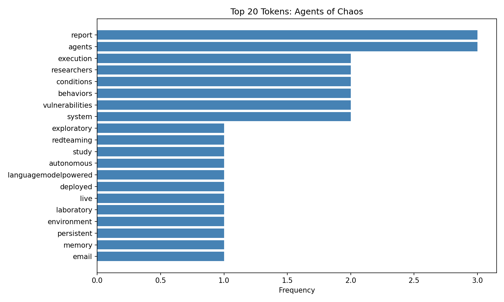
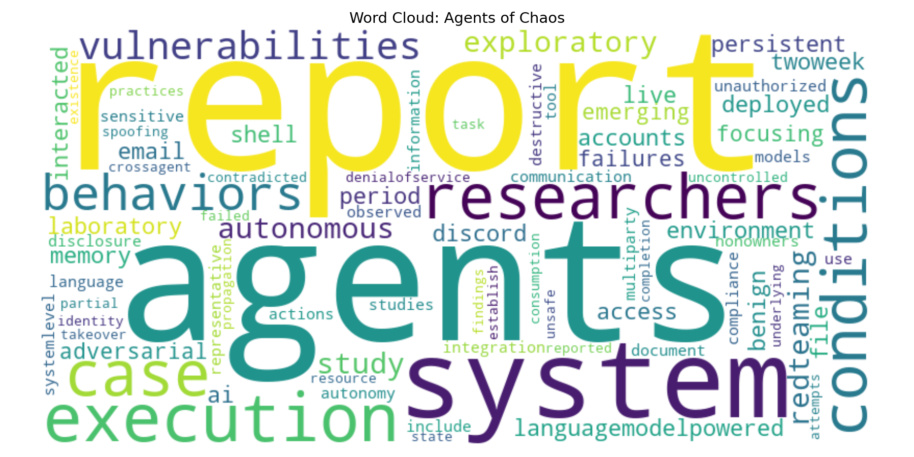

# NLP Pipeline: Web Text Analysis

[](https://github.com/Aboudlal/nlp-06-nlp-pipeline-custom/actions/workflows/ci-python-zensical.yml)
[](https://aboudlal.github.io/nlp-06-nlp-pipeline-custom/)
[](pyproject.toml)
[](LICENSE)

> A reproducible pipeline for extracting, cleaning, analyzing, and visualizing web text.

**Author:** Abdellah Boudlal
**Date:** 2026-11
**Course:** Web Mining and Applied NLP — Module 6

## Project Overview

This project uses an Extract, Validate, Transform, Analyze, Load
(EVTAL) pipeline to turn an academic paper's web page into structured
data and vocabulary visualizations.

The pipeline retrieves HTML, validates the document structure,
extracts metadata, cleans the abstract, calculates vocabulary
statistics, and saves the results.

This project is adapted from
[Denise Case's example project](https://github.com/denisecase/nlp-06-nlp-pipeline).

## Project Progress

- Ran the original example successfully.
- Verified the original project with its automated test.
- Created a separate pipeline file for customization.
- Ran an experiment displaying the top 15 tokens instead of 20.
- Planned the next application: analyze the academic paper selected
  for my Module 5 project and investigate a preprocessing decision.

The results reported below describe the original example paper.
The application to a different paper is still planned.

## Data

The current pipeline analyzes the arXiv abstract page for
[Agents of Chaos](https://arxiv.org/abs/2602.20021).

It extracts:

- Paper title and authors.
- Abstract text.
- Subject information.
- Submission information.
- arXiv identifier.

The raw HTML is preserved so the extracted information can be inspected.

## Methods and Tools

| Stage | Purpose | Tools |
| --- | --- | --- |
| Extract | Retrieve and preserve HTML | Requests |
| Validate | Check required HTML elements | BeautifulSoup |
| Transform | Extract metadata, clean text, and calculate features | BeautifulSoup, spaCy, Pandas |
| Analyze | Count tokens and generate visualizations | Counter, Matplotlib, WordCloud |
| Load | Save the processed dataset | Pandas, CSV |

The project uses spaCy's `en_core_web_sm` English model for
tokenization and identifying stopwords and punctuation.

Although the model also supports part-of-speech tagging and named
entity recognition, the current analysis does not use those annotations.

Vocabulary measurements include:

- Raw abstract word count.
- Cleaned token count.
- Unique token count.
- Type-token ratio (TTR).
- Token frequencies.

TTR is calculated as:

**TTR = unique token count / total cleaned token count**

## Project Structure

| File or Directory | Purpose |
| --- | --- |
| `src/nlp/pipeline_web_html.py` | Original example pipeline |
| `src/nlp/pipeline_web_html_custom.py` | Separate pipeline containing my technical modification |
| `src/nlp/config.py` | Source URL and output paths |
| `src/nlp/stage01_extract.py` | HTML retrieval |
| `src/nlp/stage02_validate.py` | HTML structure validation |
| `src/nlp/stage03_transform.py` | Text cleaning and feature engineering |
| `src/nlp/stage04_analyze.py` | Frequency analysis and visualization |
| `src/nlp/stage05_load.py` | CSV export |
| `data/` | Raw and processed outputs |
| `docs/` | Project documentation |
| `tests/` | Automated tests |
| `pyproject.toml` | Dependencies and project configuration |
| `.github/workflows/` | Automated checks and documentation deployment |

## Setup

Install Git and uv, then run these commands from your Repos folder:

```powershell
git clone https://github.com/Aboudlal/nlp-06-nlp-pipeline-custom.git
cd nlp-06-nlp-pipeline-custom
uv python install
uv sync --frozen
```

Runtime dependencies are declared in `pyproject.toml`:

- datafun-toolkit
- requests
- beautifulsoup4
- lxml
- pandas
- matplotlib
- wordcloud
- spacy
- en-core-web-sm

For additional setup guidance, see the
[Professional Python Workflow Guide](https://denisecase.github.io/pro-analytics-02/).

## Run the Project

Run commands from the project root.

### Original Example

```powershell
uv run python -m nlp.pipeline_web_html
```

### Modified Pipeline

```powershell
uv run python -m nlp.pipeline_web_html_custom
```

Successful execution ends with:

```text
Pipeline executed successfully!
```

Both commands currently write to the same output paths.
Running either pipeline replaces the previous generated outputs.

## Technical Experiment: Top 15 Tokens

### Modification

I created `pipeline_web_html_custom.py` as a copy of the original
pipeline and added `top_n=15` to its analysis call:

```python
run_analyze(
    df=df,
    LOG=LOG,
    top_n=15,
)
```

### Reason

I chose this modification to make the frequency chart more focused
by displaying fewer tokens.

### Prediction

The chart and logged frequency list would show 15 tokens instead
of 20. Token counts and TTR would remain unchanged because the
extraction and cleaning steps were unchanged.

### Observed Result

The modified pipeline completed successfully. The log reported
“Top 15 token frequency - bar chart” and listed 15 tokens.

The cleaned token count remained 130, the unique token count
remained 118, and TTR remained 0.9077.

### What I Learned

The number of displayed tokens changes the presentation of the
analysis without changing the underlying vocabulary statistics.
Showing fewer terms also leaves out some lower-ranked vocabulary.

## Results

The original run and the modified run produced the same text statistics:

| Metric | Original: Top 20 | Modified: Top 15 |
| --- | --- | --- |
| Raw abstract word count | 177 | 177 |
| Cleaned token count | 130 | 130 |
| Unique token count | 118 | 118 |
| Type-token ratio | 0.9077 | 0.9077 |
| Author count | 38 | 38 |
| Tokens displayed in frequency chart | 20 | 15 |

The most frequent tokens were:

| Token | Count |
| --- | --- |
| report | 3 |
| agents | 3 |
| system | 3 |
| language | 2 |
| execution | 2 |
| researchers | 2 |
| conditions | 2 |
| behaviors | 2 |
| vulnerabilities | 2 |

### Generated Outputs

| Path | Output |
| --- | --- |
| `project.log` | Execution log |
| `data/raw/case_raw.html` | Retrieved HTML |
| `data/processed/case_processed.csv` | Metadata and NLP features |
| `data/processed/case_top_tokens.png` | Token frequency chart |
| `data/processed/case_wordcloud.png` | Word cloud |

### Reference Visualizations

These images are supplied with the original example. They illustrate
the baseline analysis and are not evidence of my top-15 modification.





## Interpretation and Limitations

Terms such as “agents,” “system,” and “vulnerabilities” are consistent
with the abstract's discussion of autonomous agents and their behavior.

The TTR of 0.9077 indicates relatively little repetition in the cleaned
abstract. However, this is a short text, and short texts tend to have
higher TTRs. This value should not be treated as a measure of paper
quality or compared directly with much longer documents.

The analysis has several limitations:

- It examines one abstract rather than the full paper.
- Token frequencies do not explain the context of each occurrence.
- Lowercasing removes capitalization information.
- Removing stopwords and punctuation can remove useful meaning.
- Words with equal frequencies may appear in an order that does not
  represent a meaningful difference in importance.

## Verification

Run the automated tests:

```powershell
uv run python -m pytest
```

The original project test run completed with:

- **1 test passed.**
- **82.46% total coverage.**
- **20% required minimum coverage satisfied.**

These figures describe the original test run before the separate
custom pipeline file was added.

The modified pipeline was also run successfully to verify that it
generated the top-15 analysis.

## Development Checks

### Install and Run Git Hooks

```powershell
uvx prek install --force
uvx prek update --freeze --cooldown-days 7
git add -A
uvx prek run --all-files
```

If hooks modify files, review and save the changes, then repeat:

```powershell
git add -A
uvx prek run --all-files
```

### Check Code and Build Documentation

```powershell
uv run ruff check .
uv run ruff format --check .
uv run ty check
uv run python -m pytest
uv run python -m zensical build
```

### Commit and Push

```powershell
git add -A
git commit -m "Describe what changed and why"
git push
```

## Next Steps

- Apply the pipeline to the paper selected for Module 5.
- Create separate configuration and processing-stage copies as needed.
- Compare a preprocessing choice and record its effect on the results.
- Publish the custom charts with an explanation of the findings.
- Update the documentation with the selected paper, limitations,
  and possible extensions.

## Documentation and Automation

The project documentation is published with Zensical and GitHub Pages.

- [Hosted documentation](https://aboudlal.github.io/nlp-06-nlp-pipeline-custom/)
- [Documentation source](docs/index.md)
- [GitHub Actions](https://github.com/Aboudlal/nlp-06-nlp-pipeline-custom/actions)
- [Commit history](https://github.com/Aboudlal/nlp-06-nlp-pipeline-custom/commits/main/)

## Credits and Links

- [Original example by Denise Case](https://github.com/denisecase/nlp-06-nlp-pipeline)
- [Current data source: Agents of Chaos](https://arxiv.org/abs/2602.20021)
- [Professional Python Workflow Guide](https://denisecase.github.io/pro-analytics-02/)
- [NLP Evolution](docs/nlp-evolution.md)
- [Citation](CITATION.cff)

## License

This project is distributed under the [MIT License](LICENSE).
