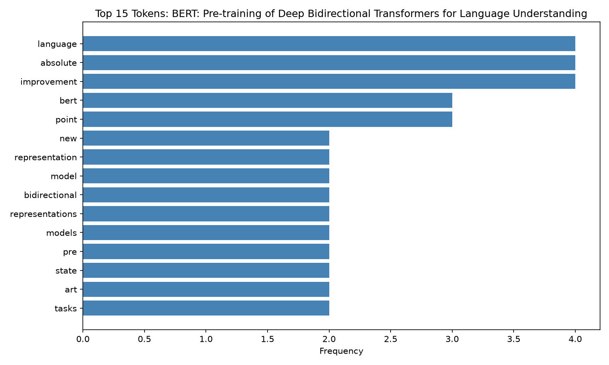
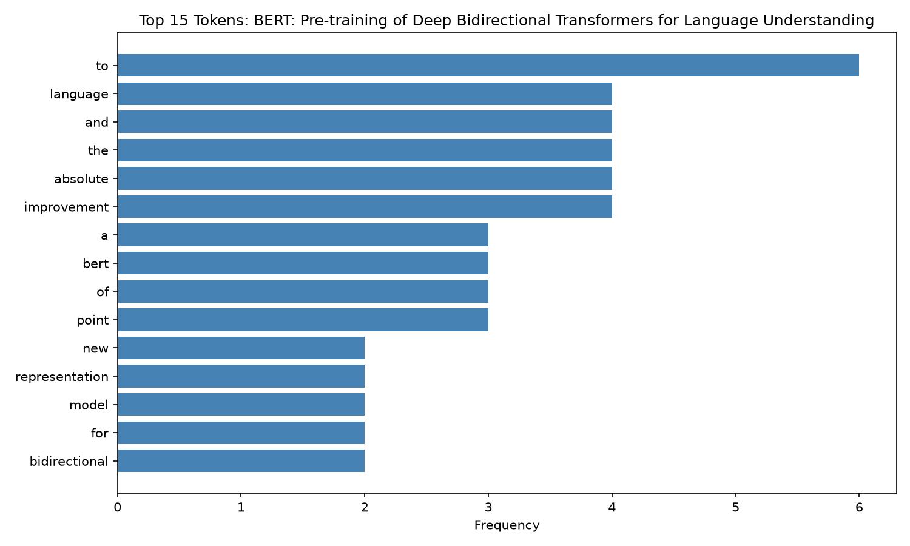
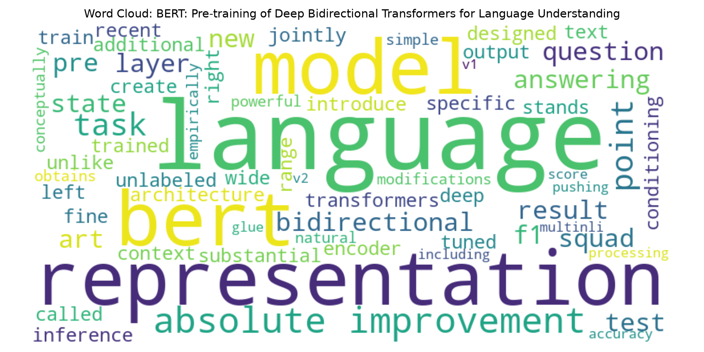

# BERT Abstract: Vocabulary and Preprocessing Analysis

**Author:** Abdellah Boudlal
**Date:** 2026-11
**Course:** Web Mining and Applied NLP — Project 06


## Peer Review — Module 7

This project is ready for peer review.

Start with the
[README setup instructions](https://github.com/Aboudlal/nlp-06-nlp-pipeline-custom#setup),
then run the custom pipeline from the repository root:

```powershell
uv run python -m nlp.pipeline_web_html_custom
```

The current version retains stopwords. Expected results are
151 processed tokens, 103 unique tokens, and a type-token ratio of 0.6821.

The pipeline also generates a frequency chart, a word cloud, and a CSV file.
Running it replaces the main output files; separate snapshots preserve
the recorded comparison.

I welcome feedback on the setup instructions, reproducibility,
visualizations, and explanation of the stopword comparison.

## Overview

This project applies an Extract, Validate, Transform, Analyze,
Load (EVTAL) pipeline to the abstract of the BERT research paper.

It builds on my Module 5 work by adding text cleaning,
tokenization, vocabulary measurements, and visualizations.

The main analytical question is:

**How does removing stopwords affect the vocabulary statistics
and most frequent tokens in the BERT abstract?**

I analyzed the same abstract twice, first removing stopwords
and then retaining them while keeping the other processing
steps unchanged.

## Data Source

The source is the arXiv abstract page for
[BERT: Pre-training of Deep Bidirectional Transformers for Language Understanding](https://arxiv.org/abs/1810.04805).

The extracted authors are Jacob Devlin, Ming-Wei Chang,
Kenton Lee, and Kristina Toutanova.

The pipeline extracts:

- Title.
- Authors.
- Abstract.
- Subject information.
- Submission information.
- arXiv identifier.

The analysis uses the abstract, not the full paper.

The extracted abstract contains 141 whitespace-separated words.
The paper has four authors.

## Tools and Methods

| Tool | Use |
| --- | --- |
| Python | Pipeline orchestration and processing |
| Requests | Retrieve the HTML page |
| BeautifulSoup | Validate HTML and extract text |
| spaCy with `en_core_web_sm` | Tokenize text and identify stopwords and punctuation |
| Pandas | Organize results and export CSV files |
| `collections.Counter` | Count token frequencies |
| Matplotlib | Create frequency bar charts |
| WordCloud | Create vocabulary visualizations |
| Logging | Record pipeline execution and results |
| Ruff, ty, and pytest | Support code verification |
| Zensical and GitHub Pages | Build and publish documentation |

The current analysis uses spaCy tokenization and token flags.
It does not analyze part-of-speech tags or named entities.

## EVTAL Workflow

### Extract

The pipeline retrieves the BERT abstract page and saves its HTML
to `data/raw/abdellah_bert_raw.html`.

### Validate

The validation stage checks that the expected title, author,
abstract, subject, and submission-date elements are present.

All five checks passed in the recorded BERT runs.

### Transform

The transformation stage extracts metadata, normalizes text,
removes punctuation and whitespace tokens, and calculates
vocabulary features.

Two preprocessing settings were compared:

1. Remove stopwords.
2. Retain stopwords.

The original transformation file remains available as an example.
My separate file, `stage03_transform_abdellah.py`, retains stopwords.

### Analyze

The analysis stage counts token frequencies and creates:

- A horizontal bar chart of the top 15 tokens.
- A word cloud.

The log also records the most frequent tokens and vocabulary metrics.

### Load

The pipeline exports the structured record to CSV.
Separate snapshots preserve both preprocessing results.

## Technical Experiment: Top 20 vs. Top 15

Before applying the pipeline to BERT, I made a small technical
modification using the original example paper, *Agents of Chaos*.

### Modification and Prediction

I created `pipeline_web_html_custom.py` and passed `top_n=15`
to the analysis function instead of using the default value of 20.

I predicted that the chart would display five fewer tokens,
while token counts and type-token ratio would remain unchanged.

### Observed Result

The modified run completed successfully and reported the top 15 tokens.

Both runs produced:

- 130 cleaned tokens.
- 118 unique tokens.
- A type-token ratio of 0.9077.

This confirmed that changing the display limit affects presentation
without changing the underlying vocabulary measurements.

## Custom Application: BERT

I changed the source from *Agents of Chaos* to the BERT paper
used in my Module 5 project.

My custom implementation includes:

- `config_abdellah.py` for the BERT URL and output paths.
- `pipeline_web_html_custom.py` for running the custom workflow.
- `stage03_transform_abdellah.py` for investigating stopword retention.
- Separate CSV snapshots and documentation images for comparison.

## Preprocessing Experiment

### Prediction

Retaining stopwords would increase the token count and allow
common grammatical words to appear among the most frequent tokens.

The effect on type-token ratio would be measured rather than assumed.

### Change

The original filter removes stopwords, punctuation, and whitespace:

```python
if not (token.is_stop or token.is_punct or token.is_space)
```

The custom filter retains stopwords:

```python
if not (token.is_punct or token.is_space)
```

The source document and the other processing steps stayed the same.

## Results

### Vocabulary Measurements

| Measurement | Stopwords Removed | Stopwords Retained |
| --- | --- | --- |
| Raw abstract word count | 141 | 141 |
| Cleaned token count | 106 | 151 |
| Unique token count | 78 | 103 |
| Type-token ratio | 0.7358 | 0.6821 |
| Author count | 4 | 4 |

Type-token ratio is calculated as:

**TTR = unique token count / total token count**

Removing stopwords excluded 45 token occurrences and 25 distinct
token types in this abstract.

Although retaining stopwords increased the number of unique tokens,
the total number of tokens increased proportionally more.
As a result, TTR decreased from 0.7358 to 0.6821.

The raw word count and processed token count use different
segmentation methods. The raw count splits on whitespace,
whereas spaCy can split a single whitespace-separated expression
into multiple tokens. Therefore, 151 processed tokens can come
from 141 raw words.

### Frequent Tokens with Stopwords Removed

| Token | Frequency |
| --- | --- |
| language | 4 |
| absolute | 4 |
| improvement | 4 |
| bert | 3 |
| point | 3 |



The chart emphasizes vocabulary related to language models
and reported performance improvements.

### Frequent Tokens with Stopwords Retained

| Token | Frequency |
| --- | --- |
| to | 6 |
| language | 4 |
| and | 4 |
| the | 4 |
| absolute | 4 |
| improvement | 4 |



The word “to” becomes the most frequent token. Common words such
as “and” and “the” also occupy positions in the top-15 chart.

### Word Cloud



The word cloud provides a quick visual overview.
The bar charts and frequency tables provide more precise comparisons.

## Interpretation

For this abstract, stopword removal makes the frequency chart
more focused on topic-related terms.

The frequent words “language” and “bert” reflect the paper's
subject, while “absolute,” “improvement,” and “point” reflect
its discussion of evaluation results.

These counts describe word usage. They do not independently
verify the paper's performance claims.

Retaining stopwords preserves more grammatical information,
but common words occupy more of the limited space in the
top-token chart.

Neither setting is universally better. Stopword removal is useful
for this vocabulary overview, while tasks requiring sentence meaning
may need words that a stopword filter removes.

The change in TTR demonstrates that vocabulary measurements depend
on preprocessing choices. A higher TTR after filtering does not
mean that the source document became better or more informative.

## Tradeoffs and Limitations

- The analysis covers one abstract rather than the full paper.
- TTR depends on text length, tokenization, and cleaning choices.
- Lowercasing removes distinctions conveyed by capitalization.
- Removing punctuation can break meaningful expressions.
- Removing stopwords can discard useful grammatical information.
- No lemmatization is applied, so forms such as “model” and “models”
  remain separate tokens.
- Frequency counts do not capture sentence context or semantic importance.
- The WordCloud library applies its own default processing, including
  stopword filtering, when generating an image from text. The word
  cloud should therefore not be used as an exact representation of
  the retained-stopword frequency table.

The bar charts, logged counts, and CSV metrics are the primary
evidence for the stopword comparison.

## Verification

The original example pipeline completed successfully.

The initial automated test run reported:

- One test passed.
- 82.46% total coverage.
- The required minimum coverage of 20% was satisfied.

These figures describe the initial test run before the custom files
were added; they are not a new coverage measurement of the final project.

Both BERT preprocessing runs completed with:

```text
Pipeline executed successfully!
```

The logs confirmed successful HTML validation, feature calculation,
visualization generation, and CSV export.

### Run the Custom Pipeline

From the repository root:

```powershell
uv sync --frozen
uv run python -m nlp.pipeline_web_html_custom
```

The current custom transformation retains stopwords.

To reproduce the stopword-removed version, use this import in
`pipeline_web_html_custom.py`:

```python
from nlp.stage03_transform import run_transform
```

To reproduce the retained-stopword version, use:

```python
from nlp.stage03_transform_abdellah import run_transform
```

Run the custom pipeline after selecting the desired import.
The two settings write to the same main output paths, so preserve
the results before switching settings.

## Saved Artifacts

The CSV filenames below refer to whether stopwords are present
in the saved tokens.

- [BERT results with stopwords removed](https://github.com/Aboudlal/nlp-06-nlp-pipeline-custom/blob/main/data/processed/abdellah_bert_without_stopwords.csv)
- [BERT results with stopwords retained](https://github.com/Aboudlal/nlp-06-nlp-pipeline-custom/blob/main/data/processed/abdellah_bert_with_stopwords.csv)
- [Retrieved BERT HTML](https://github.com/Aboudlal/nlp-06-nlp-pipeline-custom/blob/main/data/raw/abdellah_bert_raw.html)
- [Top-15 chart with stopwords removed](images/bert_top15.png)
- [Top-15 chart with stopwords retained](images/bert_top15_with_stopwords.png)
- [Word cloud with stopwords removed](images/bert_wordcloud.png)

## Next Steps

If I continued this project, I would:

- Add a configuration option to switch stopword removal on and off.
- Save each preprocessing run to a separate output directory automatically.
- Generate word clouds directly from the measured token frequencies.
- Compare lemmatized and non-lemmatized vocabulary.
- Investigate how hyphenated expressions are represented.
- Extend the analysis to multiple abstracts with attention to text length.

## Project Links

- [GitHub Repository](https://github.com/Aboudlal/nlp-06-nlp-pipeline-custom)
- [README and Setup Instructions](https://github.com/Aboudlal/nlp-06-nlp-pipeline-custom/blob/main/README.md)
- [Custom Pipeline](https://github.com/Aboudlal/nlp-06-nlp-pipeline-custom/blob/main/src/nlp/pipeline_web_html_custom.py)
- [Custom Configuration](https://github.com/Aboudlal/nlp-06-nlp-pipeline-custom/blob/main/src/nlp/config_abdellah.py)
- [Custom Transform Stage](https://github.com/Aboudlal/nlp-06-nlp-pipeline-custom/blob/main/src/nlp/stage03_transform_abdellah.py)
- [Analyze Stage](https://github.com/Aboudlal/nlp-06-nlp-pipeline-custom/blob/main/src/nlp/stage04_analyze.py)
- [Commit History](https://github.com/Aboudlal/nlp-06-nlp-pipeline-custom/commits/main/)
- [GitHub Actions](https://github.com/Aboudlal/nlp-06-nlp-pipeline-custom/actions)

## Resources and Credits

Adapted from the example project by Denise Case.

- [Original Example Repository](https://github.com/denisecase/nlp-06-nlp-pipeline)
- [BERT Paper](https://arxiv.org/abs/1810.04805)
- [Project Instructions](project-instructions.md)
- [Glossary](glossary.md)
- [NLP Evolution](nlp-evolution.md)
- [Professional Python Guide](https://denisecase.github.io/pro-analytics-02/)
- [Professional Python Project Explainer](https://pup-pack.github.io/professional-python-project-explainer/)
